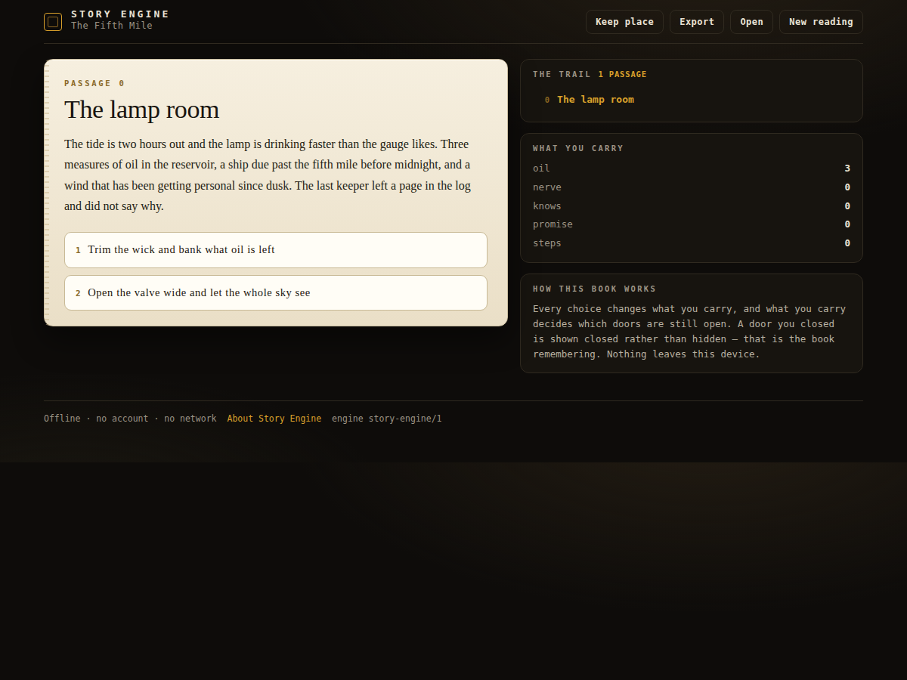

# app-story-engine

<!-- shot:start -->



<!-- shot:end -->

[](https://drsamonline.github.io/app-story-engine/)
[](https://github.com/drsamonline/app-story-engine/releases/latest)
[](test-node.js)
[](LICENSE)

**A book the reader moves through: choices, carried state, and a map of where you have been** — offline, no accounts, no telemetry.

Read it: <https://drsamonline.github.io/app-story-engine/play/> · About it: <https://drsamonline.github.io/app-story-engine/>

## Why it exists

A "choose your own adventure" app usually forgets what you chose: the branches are a tree of
screens and the reader is a click. This one makes **the state the story**. What you pick changes
what you carry; what you carry decides which doors are still open; and the trail shows every
passage you have been through, in the order you went through them — return visits included.

## What is here

| File | What it is |
| --- | --- |
| `docs/play/story-engine.js` | the engine — `compile`, `newGame`, `choicesFor`, `advance`, `trail`, `save`, `load`, `createStore` |
| `docs/play/book.js` | *The Fifth Mile* — the book that ships with it, as data |
| `docs/play/index.html` | the reader — passage, choices, closed doors, the trail, the state you carry |
| `docs/index.html` | the landing page |
| `test-node.js` | `node test-node.js` — 141 assertions over the real engine and the real book |

## The four things it promises

1. **A choice leads to a different passage.** Two choices at one passage go to two different
   passages. A choice that does not exist is refused **with the passage shown**.
2. **The same choices produce the same ending.** The engine has no clock, no dice and no `eval`.
   Replay and you get the same state, the same trail, the same ending.
3. **The trail is every passage, in order.** A return visit is recorded again, not collapsed into a set.
4. **A failure is reported, never smoothed over.** A full disk stops the *saving*, not the reading.
   A corrupt save is reported with the passage it claims and offered for export — the app never
   resumes at the beginning and calls it your place.

## Run it

Open `docs/play/index.html`. That is the whole app — the two kits it uses sit next to it, so it
works from `file://`, a USB stick, or GitHub Pages.

```bash
node test-node.js          # 141 assertions
```

## Licence

PolyForm Noncommercial 1.0.0. (c) 2026 Dr Sohil Momin. Free for any noncommercial purpose;
commercial use needs a licence from the author.
